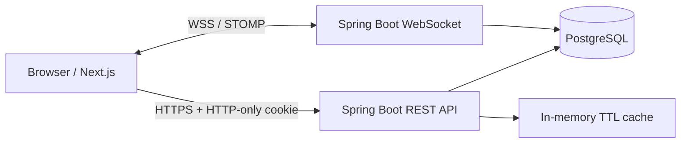

# Architecture

The browser communicates with the Next.js frontend. The frontend calls the Spring Boot API for business operations. The backend owns validation, authorization, booking transactions and persistence. WebSocket events are authenticated and authorized server-side for every subscription and message.
